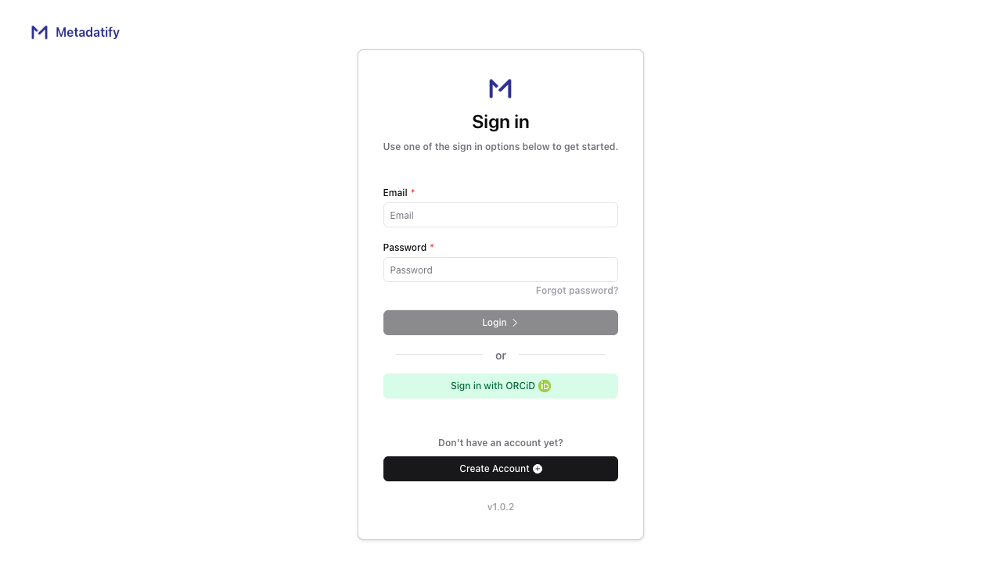
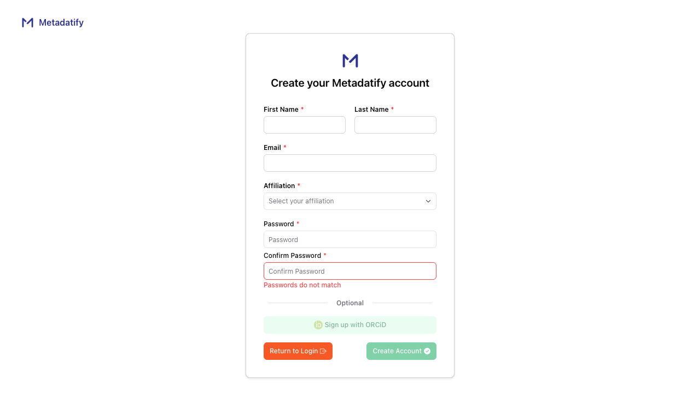
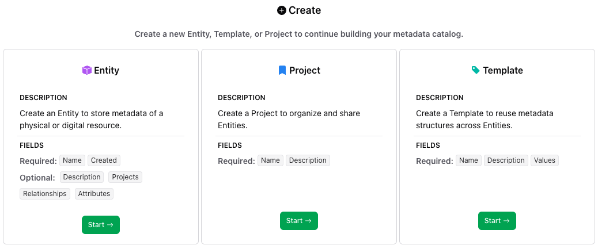
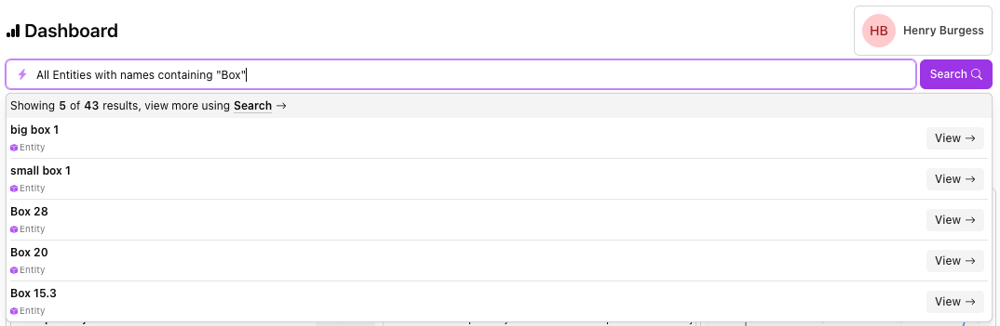
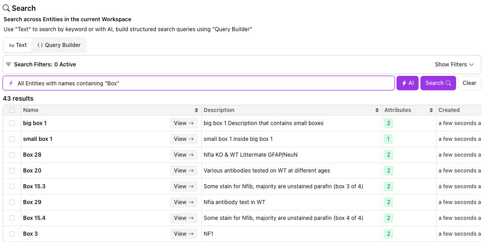

# Quickstart

This guide takes you from your first login to your first Entity, Project, and search. It takes about ten minutes.

If you're new to terms like Entity, Project, and Attribute, read [Terminology](Terminology.md) first.

## 1. Create an account and log in

Go to [app.metadatify.com](https://app.metadatify.com) and create an account.

Enter your name, email address, and affiliation, then choose a password. Your email address is used for collaboration and notifications. You can link your ORCiD later from your account settings.

See [Accounts](Accounts.md) for more about account settings.

## 2. Create your first Workspace

A Workspace holds your Entities, Projects, and Attributes, and the people you share them with. The first time you log in, Metadatify asks you to create one, unless someone has already added you to their Workspace.

1. Enter a **Name** for the Workspace, for example your lab's name.
2. Optionally, add a **Description** and the people you want to collaborate with.
3. Click **Create**.

You'll land on the Workspace's Dashboard. See [Workspaces](Workspaces.md) for managing Workspaces later.

## 3. Create your first Entity

An Entity is a single thing you track, such as a sample, specimen, or reagent.

1. In the sidebar, under **Tools**, click **Create**. In the dialog that opens, click **Start** on the **Entity** option.

   

2. **Start:** enter a **Name**, check the **Created** date, and add a **Description**. Click **Continue**.
3. **Projects:** you don't have a Project yet, so click **Continue**.
4. **Links:** you can link this Entity to other Entities later. Click **Continue**.
5. **Attributes:** add structured metadata, such as a storage location or collection date. You can choose an existing Attribute or create one for this Entity. Click **Finish**.

Create a second Entity the same way, so you have something to group in the next step.

See [Creating Entities](creating/Creating-Entities.md) for every field and option.

## 4. Create your first Project

A Project groups related Entities, such as an experimental cohort or a batch of samples.

1. Under **Tools**, click **Create**, then click **Start** on the **Project** option.
2. Enter a **Name** and a **Description**.
3. Add the two Entities you created.
4. Click **Finish**.

Open either Entity and you'll see the Project listed on it. See [Creating Projects](creating/Creating-Projects.md) for more.

## 5. Search your metadata

The quickest way to search is the search bar at the top of the Dashboard. Type part of an Entity's name or description to see the top matches.

For more options, click **Search** in the sidebar:

- The **Text** tab searches across Entity names, descriptions, and metadata, with filters for dates and Entity contents.
- The **Query Builder** tab combines rules on specific fields: name, description, Projects, links, and Attributes.

If your account has AI features turned on, an **AI** option lets you search in plain language. See [Searching](Searching.md) for details.

## Next steps

- [Import existing metadata](data_management/Importing-Data.md) from CSV, XLSX, or JSON files
- [Create reusable Attributes](creating/Creating-Attributes.md) so similar Entities share the same structure
- [Track physical samples](Tracking.md) with barcode and QR code labels
- [Export metadata](data_management/Exporting-Data.md) as CSV, XLSX, or JSON
